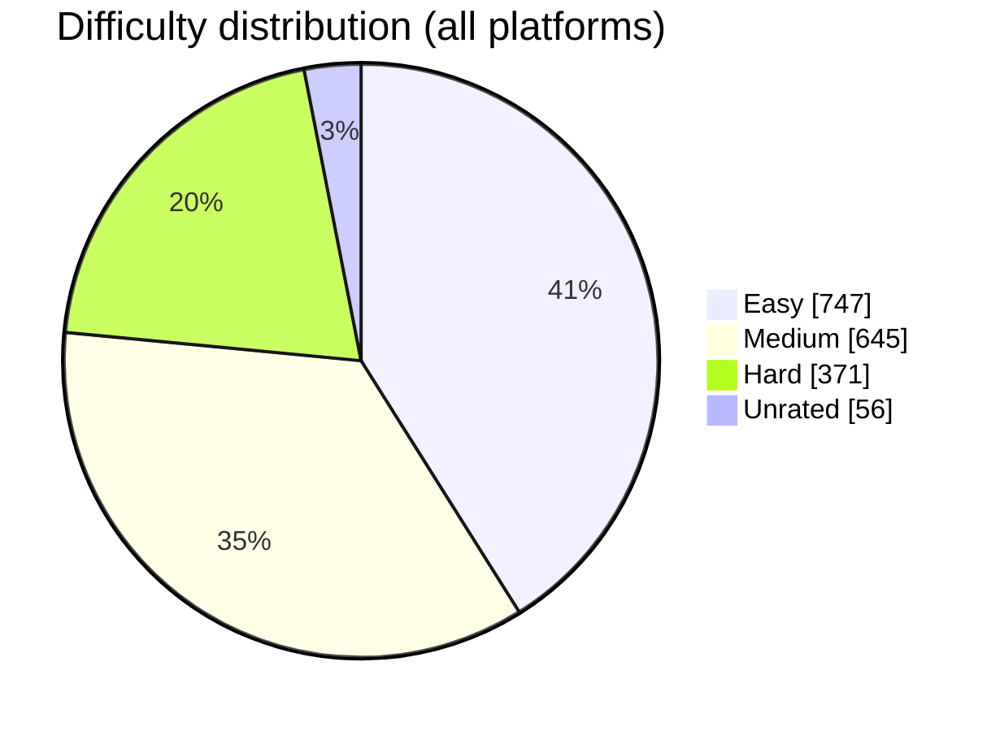

<div align="center">


<a href="https://github.com/BuildbyArindam"></a>


</div>

---

## ⚡ At a Glance

| 🧮 Solutions in repo | 🟢 Easy | 🟡 Medium | 🔴 Hard | 📅 Active days | 🔥 Longest streak |
|:---:|:---:|:---:|:---:|:---:|:---:|
| **1,819** | **747** | **645** | **371** | **102** | **81 days** |

> 📆 Logging window: **15 Aug 2026 → 25 Nov 2026** &nbsp;•&nbsp; Every file has a header with problem link, date, difficulty, topics, approach and complexity.

---

## 🔗 Coding Profiles

<div align="center">

| Platform | Handle | Link |
|:--|:--|:--:|
| 🟠 LeetCode | `0Arindam0_` | [Visit](https://leetcode.com/u/0Arindam0_/) |
| 🟢 GeeksforGeeks | `subirouynn` | [Visit](https://www.geeksforgeeks.org/user/subirouynn/) |
| 🔵 Codeforces | `mahapatraarindam4` | [Visit](https://codeforces.com/profile/mahapatraarindam4) |
| 🟤 CodeChef | `amahapatra2004` | [Visit](https://www.codechef.com/users/amahapatra2004) |
| 🟣 HackerEarth | `mahapatraarindam4` | [Visit](https://www.hackerearth.com/@mahapatraarindam4/) |
| 🟡 Unstop | `arindmah7062` | [Visit](https://unstop.com/u/arindmah7062) |
| 🧡 Coding Ninjas (Code360) | `Profile` | [Visit](https://www.naukri.com/code360/profile/fd676eb2-50b1-413c-aeea-3e8ea44e0a46) |
| ⚪ freeCodeCamp | `Profile` | [Visit](https://www.freecodecamp.org/fccdee8d2f5-58e1-4b09-9d09-2e7dafec471b) |
| 🟩 HackerRank | `mahapatraarinda1` | [Visit](http://www.hackerrank.com/profile/mahapatraarinda1) |

### 🔥 Streaks by Platform

<sub>Counted from the dated solution files in this repo, so they update automatically.</sub>

| Platform | 🔥 Current | 🏆 Longest | 📅 Active days | 🕒 Last solved |
|:--|--:|--:|--:|:--:|
| 🟠 LeetCode | **5** days | **49** days | 69 | 25 Nov 2026 |
| 🟢 GeeksforGeeks | **3** days | **71** days | 76 | 24 Nov 2026 |
| 🔵 Codeforces | **0** days | **9** days | 25 | 11 Sep 2026 |
| 🟤 CodeChef | **0** days | **35** days | 71 | 28 Oct 2026 |
| 🟣 HackerEarth | **3** days | **40** days | 78 | 24 Nov 2026 |
| 🟡 Unstop | **19** days | **37** days | 91 | 24 Nov 2026 |
| 🧡 Coding Ninjas (Code360) | **0** days | **7** days | 25 | 03 Oct 2026 |
| ⚪ freeCodeCamp | **0** days | **14** days | 20 | 19 Sep 2026 |


</div>

---

## 📂 Repository Structure

```text
Daily-Coding-Log/
└── DSA-Practice/
    ├── CodeChef/        # 520 solutions
    ├── HackerEarth/     # 372 solutions
    ├── LeetCode/        # 272 solutions
    ├── Code360/         # 193 solutions
    ├── FreeCodeCamp/    # 184 solutions
    ├── Codeforces/      # 108 solutions
    ├── Unstop/          # 93 solutions
    └── GeeksforGeeks/   # 77 solutions
```

---

## 📊 Progress by Platform

> **In repo** = solution files uploaded here (counted automatically). **Platform total** = problems solved on the site itself (manual figures).

| Platform | In repo | Share | Platform total | 🟢 Easy | 🟡 Medium | 🔴 Hard | ⚪ Unrated |
|:--|--:|:--|--:|--:|--:|--:|--:|
| [CodeChef](https://www.codechef.com/users/amahapatra2004) | **520** | `███░░░░░░░░░` 29% | 142 | 194 | 160 | 137 | 29 |
| [HackerEarth](https://www.hackerearth.com/@mahapatraarindam4/) | **372** | `██░░░░░░░░░░` 20% | 154 | 223 | 121 | 15 | 13 |
| [LeetCode](https://leetcode.com/u/0Arindam0_/) | **272** | `██░░░░░░░░░░` 15% | 1,599 | 76 | 91 | 105 | 0 |
| [Code360](https://www.naukri.com/code360/profile/fd676eb2-50b1-413c-aeea-3e8ea44e0a46) | **193** | `█░░░░░░░░░░░` 11% | 111 | 89 | 70 | 34 | 0 |
| [FreeCodeCamp](https://www.freecodecamp.org/fccdee8d2f5-58e1-4b09-9d09-2e7dafec471b) | **184** | `█░░░░░░░░░░░` 10% | 300 | 116 | 60 | 2 | 6 |
| [Codeforces](https://codeforces.com/profile/mahapatraarindam4) | **108** | `█░░░░░░░░░░░` 6% | 217 | 19 | 50 | 35 | 4 |
| [Unstop](https://unstop.com/u/arindmah7062) | **93** | `█░░░░░░░░░░░` 5% | 668 | 11 | 49 | 31 | 2 |
| [GeeksforGeeks](https://www.geeksforgeeks.org/user/subirouynn/) | **77** | `█░░░░░░░░░░░` 4% | 1,315 | 19 | 44 | 12 | 2 |
| **Total** | **1,819** | | | **747** | **645** | **371** | **56** |

_HackerRank (400 solved on the site) has no folder in this repo yet._

### 🎯 Difficulty Split



> **How difficulty is normalised:** Easy / Cakewalk / Beginner → Easy · Easy-Medium → Medium · Medium-Hard → Hard · Codeforces ≤1200 Easy, 1300–1900 Medium, 2000+ Hard · CodeChef rating <1200 Easy, 1200–1799 Medium, 1800+ Hard · files with no difficulty label → Unrated.

---

## 🧩 Progress by Topic

> A solution can carry several topics, so the counts add up to more than the total.

| Topic | Solutions | Distribution |
|:--|--:|:--|
| Implementation & Simulation | **558** | `████████████████████████` |
| Arrays & Prefix Sums | **493** | `█████████████████████░░░` |
| Math & Number Theory | **441** | `███████████████████░░░░░` |
| Sorting & Searching | **381** | `████████████████░░░░░░░░` |
| Hashing & Maps | **277** | `████████████░░░░░░░░░░░░` |
| Strings | **253** | `███████████░░░░░░░░░░░░░` |
| Greedy | **241** | `██████████░░░░░░░░░░░░░░` |
| Trees | **218** | `█████████░░░░░░░░░░░░░░░` |
| Stacks, Queues & Heaps | **186** | `████████░░░░░░░░░░░░░░░░` |
| Dynamic Programming | **181** | `████████░░░░░░░░░░░░░░░░` |
| Graphs | **170** | `███████░░░░░░░░░░░░░░░░░` |
| Two Pointers & Sliding Window | **139** | `██████░░░░░░░░░░░░░░░░░░` |
| Recursion & Backtracking | **99** | `████░░░░░░░░░░░░░░░░░░░░` |
| Design / OOP / SQL | **95** | `████░░░░░░░░░░░░░░░░░░░░` |
| Bit Manipulation | **92** | `████░░░░░░░░░░░░░░░░░░░░` |
| Linked Lists | **27** | `█░░░░░░░░░░░░░░░░░░░░░░░` |

---

## 🏆 Codeforces Rating Ladder

| Rating band | Solved | |
|:--|--:|:--|
| ≤ 1200 | **19** | `███████████████░░░░░` |
| 1300 – 1600 | **25** | `████████████████████` |
| 1700 – 1900 | **25** | `████████████████████` |
| 2000 – 2300 | **20** | `████████████████░░░░` |
| 2400+ | **15** | `████████████░░░░░░░░` |

### 💎 Hall of Fame (hardest solved)

| Rating | Problem | Solution |
|:--:|:--|:--:|
| ⭐ **2800** | DravDe Saves The World | [Code](https://github.com/BuildbyArindam/Daily-Coding-Log/blob/main/DSA-Practice/Codeforces/28E_DravDe_Saves_The_World.py) |
| ⭐ **2700** | BerPaint | [Code](https://github.com/BuildbyArindam/Daily-Coding-Log/blob/main/DSA-Practice/Codeforces/44F_BerPaint.py) |
| ⭐ **2700** | A Colourful Prospect | [Code](https://github.com/BuildbyArindam/Daily-Coding-Log/blob/main/DSA-Practice/Codeforces/934E_A_Colourful_Prospect.py) |
| ⭐ **2600** | Trial for Chief | [Code](https://github.com/BuildbyArindam/Daily-Coding-Log/blob/main/DSA-Practice/Codeforces/37E_Trial_for_Chief.py) |
| ⭐ **2600** | Testing | [Code](https://github.com/BuildbyArindam/Daily-Coding-Log/blob/main/DSA-Practice/Codeforces/39K_Testing.py) |
| ⭐ **2600** | Interesting Sequence | [Code](https://github.com/BuildbyArindam/Daily-Coding-Log/blob/main/DSA-Practice/Codeforces/40D_Interesting_Sequence.py) |
| ⭐ **2500** | Alex and a TV Show | [Code](https://github.com/BuildbyArindam/Daily-Coding-Log/blob/main/DSA-Practice/Codeforces/1097F_Alex_and_a_TV_Show.py) |
| ⭐ **2500** | Tram | [Code](https://github.com/BuildbyArindam/Daily-Coding-Log/blob/main/DSA-Practice/Codeforces/39I_Tram.py) |

---

## 🌍 Hall of Fame: Hardest Solved on Other Platforms

> Top 10 outside Codeforces (max 2 per platform). Ranked by a difficulty score: the site rating where one exists (CodeChef), otherwise the **Hard** label plus a bonus for advanced techniques in the topic list (segment tree, FFT, flow, persistent structures...).

| # | Platform | Problem | Level | Key techniques | Solution |
|:--:|:--|:--|:--:|:--|:--:|
| 1 | CodeChef | AVOIDINGM2 Avoiding M Hard | ⭐ **2322** | Combinatorics, Inclusion-Exclusion, FFT/NTT-style Convolution | [Code](https://github.com/BuildbyArindam/Daily-Coding-Log/blob/main/DSA-Practice/CodeChef/AVOIDINGM2_Avoiding_M_Hard.py) |
| 2 | CodeChef | LEREO Learning Resource Optimization | ⭐ **2316** | Dynamic Programming, Grouped Knapsack | [Code](https://github.com/BuildbyArindam/Daily-Coding-Log/blob/main/DSA-Practice/CodeChef/LEREO_Learning_Resource_Optimization.py) |
| 3 | HackerEarth | Prefix and Substring Queries | 🔴 Hard | KMP, Trees, HLD | [Code](https://github.com/BuildbyArindam/Daily-Coding-Log/blob/main/DSA-Practice/HackerEarth/Prefix_and_Substring_Queries.py) |
| 4 | Unstop | Live Wire Junctions | 🔴 Hard | Tree, Heavy-Light Decomposition, Fenwick Tree | [Code](https://github.com/BuildbyArindam/Daily-Coding-Log/blob/main/DSA-Practice/Unstop/Live_Wire_Junctions.py) |
| 5 | Unstop | The Exposure Ledger | 🔴 Hard | Persistent Segment Tree, Fenwick Tree, Coordinate Compression | [Code](https://github.com/BuildbyArindam/Daily-Coding-Log/blob/main/DSA-Practice/Unstop/The_Exposure_Ledger.py) |
| 6 | HackerEarth | Puzzled Grid | 🔴 Hard | Kruskal Reconstruction Tree, DSU, Binary Lifting | [Code](https://github.com/BuildbyArindam/Daily-Coding-Log/blob/main/DSA-Practice/HackerEarth/Puzzled_Grid.py) |
| 7 | LeetCode | 1569 Number of Ways to Reorder Array to Get Same BST | 🔴 Hard | Array, Math, Divide and Conquer | [Code](https://github.com/BuildbyArindam/Daily-Coding-Log/blob/main/DSA-Practice/LeetCode/Hard/1569_Number_of_Ways_to_Reorder_Array_to_Get_Same_BST.py) |
| 8 | LeetCode | 1872 Stone Game VIII | 🔴 Hard | Array, Math, DP | [Code](https://github.com/BuildbyArindam/Daily-Coding-Log/blob/main/DSA-Practice/LeetCode/Hard/1872_Stone_Game_VIII.py) |
| 9 | Code360 | Ninja and the Nested Ranges II | 🔴 Hard | Fenwick Tree / BIT, Coordinate Compression, Offline Query Processing | [Code](https://github.com/BuildbyArindam/Daily-Coding-Log/blob/main/DSA-Practice/Code360/Ninja_and_the_Nested_Ranges_II.py) |
| 10 | Code360 | Kth Element of Two Sorted Arrays | 🔴 Hard | Binary Search on Partitions, Arrays, Divide and Conquer | [Code](https://github.com/BuildbyArindam/Daily-Coding-Log/blob/main/DSA-Practice/Code360/Kth_Element_of_Two_Sorted_Arrays.py) |

---

## 📅 Recent Activity (latest solves)

| Date | Platform | Problem | Difficulty | Solution |
|:--|:--|:--|:--:|:--:|
| 2026-11-25 | LeetCode | 862 Shortest Subarray with Sum at Least K | 🔴 Hard | [Code](https://github.com/BuildbyArindam/Daily-Coding-Log/blob/main/DSA-Practice/LeetCode/Hard/862_Shortest_Subarray_with_Sum_at_Least_K.cpp) |
| 2026-11-25 | LeetCode | 834 Sum of Distances in Tree | 🔴 Hard | [Code](https://github.com/BuildbyArindam/Daily-Coding-Log/blob/main/DSA-Practice/LeetCode/Hard/834_Sum_of_Distances_in_Tree.cpp) |
| 2026-11-25 | LeetCode | 773 Sliding Puzzle | 🔴 Hard | [Code](https://github.com/BuildbyArindam/Daily-Coding-Log/blob/main/DSA-Practice/LeetCode/Hard/773_Sliding_Puzzle.cpp) |
| 2026-11-25 | LeetCode | 2577 Minimum Time to Visit a Cell In a Grid | 🔴 Hard | [Code](https://github.com/BuildbyArindam/Daily-Coding-Log/blob/main/DSA-Practice/LeetCode/Hard/2577_Minimum_Time_to_Visit_a_Cell_In_a_Grid.cpp) |
| 2026-11-25 | LeetCode | 1675 Minimize Deviation in Array | 🔴 Hard | [Code](https://github.com/BuildbyArindam/Daily-Coding-Log/blob/main/DSA-Practice/LeetCode/Hard/1675_Minimize_Deviation_in_Array.cpp) |
| 2026-11-24 | Unstop | Whispers of the Camera Traps | 🟡 Medium | [Code](https://github.com/BuildbyArindam/Daily-Coding-Log/blob/main/DSA-Practice/Unstop/Whispers_of_the_Camera_Traps.py) |
| 2026-11-24 | GeeksforGeeks | Two Pairs with Same Sum | 🟡 Medium | [Code](https://github.com/BuildbyArindam/Daily-Coding-Log/blob/main/DSA-Practice/GeeksforGeeks/Two_Pairs_with_Same_Sum.py) |
| 2026-11-24 | HackerEarth | Too Chocolatey | 🟢 Easy | [Code](https://github.com/BuildbyArindam/Daily-Coding-Log/blob/main/DSA-Practice/HackerEarth/Too_Chocolatey.py) |
| 2026-11-24 | LeetCode | 632 Smallest Range Covering Elements from K Lists | 🔴 Hard | [Code](https://github.com/BuildbyArindam/Daily-Coding-Log/blob/main/DSA-Practice/LeetCode/Hard/632_Smallest_Range_Covering_Elements_from_K_Lists.cpp) |
| 2026-11-24 | LeetCode | 564 Find the Closest Palindrome | 🔴 Hard | [Code](https://github.com/BuildbyArindam/Daily-Coding-Log/blob/main/DSA-Practice/LeetCode/Hard/564_Find_the_Closest_Palindrome.cpp) |
| 2026-11-24 | LeetCode | 3411 Maximum Subarray With Equal Products | 🟢 Easy | [Code](https://github.com/BuildbyArindam/Daily-Coding-Log/blob/main/DSA-Practice/LeetCode/Easy/3411_Maximum_Subarray_With_Equal_Products.py) |
| 2026-11-24 | LeetCode | 2246 Longest Path With Different Adjacent Characters | 🔴 Hard | [Code](https://github.com/BuildbyArindam/Daily-Coding-Log/blob/main/DSA-Practice/LeetCode/Hard/2246_Longest_Path_With_Different_Adjacent_Characters.java) |
| 2026-11-24 | LeetCode | 1671 Minimum Number of Removals to Make Mountain Array | 🔴 Hard | [Code](https://github.com/BuildbyArindam/Daily-Coding-Log/blob/main/DSA-Practice/LeetCode/Hard/1671_Minimum_Number_of_Removals_to_Make_Mountain_Array.cpp) |
| 2026-11-24 | LeetCode | 1106 Parsing A Boolean Expression | 🔴 Hard | [Code](https://github.com/BuildbyArindam/Daily-Coding-Log/blob/main/DSA-Practice/LeetCode/Hard/1106_Parsing_A_Boolean_Expression.cpp) |
| 2026-11-23 | Unstop | Ember Loads at Cobalt Pottery | 🟢 Easy | [Code](https://github.com/BuildbyArindam/Daily-Coding-Log/blob/main/DSA-Practice/Unstop/Ember_Loads_at_Cobalt_Pottery.py) |

---

## 🎯 Goals

- [x] Reach 1,000 solutions in this repo
- [ ] Reach 2,000 solutions in this repo (**1,819** so far)
- [ ] Reach 3,000 solutions in this repo
- [ ] Upload 500 LeetCode solutions (**272** so far)
- [ ] Solve 500 Hard problems across platforms (**371** so far)
- [ ] Every platform folder at 100+ solutions (lowest: **GeeksforGeeks** with 77)
- [ ] Practise on 9+ platforms by adding a HackerRank folder (**8** now)
- [ ] Solve a Codeforces problem rated 3000+ (hardest so far: **2800**)
- [ ] Keep a 30-day streak (current: **21** days)
- [ ] Keep a 100-day streak
- [ ] Be active on 200 different days (**102** so far)
- [ ] Take part in at least one live contest every week (LeetCode / Codeforces / CodeChef)

---

<div align="center">

*Consistency over intensity — one problem at a time.* 🚀

<sub>Last auto-updated: 25 Nov 2026 by <code>scripts/update_readme.py</code></sub>


</div>
