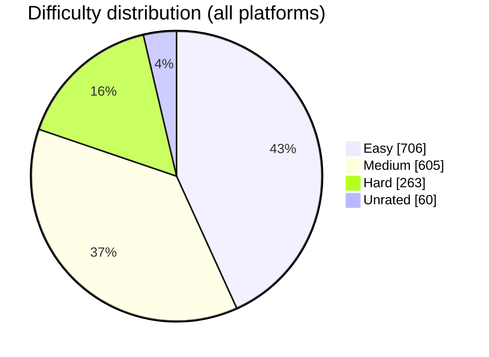

<div align="center">


<a href="https://github.com/BuildbyArindam"></a>


</div>

---

## ⚡ At a Glance

| 🧮 Solutions in repo | 🟢 Easy | 🟡 Medium | 🔴 Hard | 📅 Active days | 🔥 Longest streak |
|:---:|:---:|:---:|:---:|:---:|:---:|
| **1,634** | **706** | **605** | **263** | **68** | **68 days** |

> 📆 Logging window: **15 Aug 2026 → 21 Oct 2026** &nbsp;•&nbsp; Every file has a header with problem link, date, difficulty, topics, approach and complexity.

---

## 🔗 Coding Profiles

<div align="center">

| Platform | Handle | Link |
|:--|:--|:--:|
| 🟠 LeetCode | `0Arindam0_` | [Visit](https://leetcode.com/u/0Arindam0_/) |
| 🟢 GeeksforGeeks | `subirouynn` | [Visit](https://www.geeksforgeeks.org/user/subirouynn/) |
| 🔵 Codeforces | `mahapatraarindam4` | [Visit](https://codeforces.com/profile/mahapatraarindam4) |
| 🟤 CodeChef | `amahapatra2004` | [Visit](https://www.codechef.com/users/amahapatra2004) |
| 🟣 HackerEarth | `mahapatraarindam4` | [Visit](https://www.hackerearth.com/@mahapatraarindam4/) |
| 🟡 Unstop | `arindmah7062` | [Visit](https://unstop.com/u/arindmah7062) |
| 🧡 Coding Ninjas (Code360) | `Profile` | [Visit](https://www.naukri.com/code360/profile/fd676eb2-50b1-413c-aeea-3e8ea44e0a46) |
| ⚪ freeCodeCamp | `Profile` | [Visit](https://www.freecodecamp.org/fccdee8d2f5-58e1-4b09-9d09-2e7dafec471b) |
| 🟩 HackerRank | `mahapatraarinda1` | [Visit](http://www.hackerrank.com/profile/mahapatraarinda1) |


</div>

---

## 📂 Repository Structure

```text
Daily-Coding-Log/
└── DSA-Practice/
    ├── CodeChef/        # 467 solutions
    ├── HackerEarth/     # 353 solutions
    ├── LeetCode/        # 197 solutions
    ├── Code360/         # 193 solutions
    ├── FreeCodeCamp/    # 184 solutions
    ├── Codeforces/      # 108 solutions
    ├── GeeksforGeeks/   # 67 solutions
    └── Unstop/          # 65 solutions
```

---

## 📊 Progress by Platform

> **In repo** = solution files uploaded here (counted automatically). **Platform total** = problems solved on the site itself (manual figures).

| Platform | In repo | Share | Platform total | 🟢 Easy | 🟡 Medium | 🔴 Hard | ⚪ Unrated |
|:--|--:|:--|--:|--:|--:|--:|--:|
| [CodeChef](https://www.codechef.com/users/amahapatra2004) | **467** | `███░░░░░░░░░` 29% | 142 | 185 | 149 | 104 | 29 |
| [HackerEarth](https://www.hackerearth.com/@mahapatraarindam4/) | **353** | `███░░░░░░░░░` 22% | 154 | 206 | 120 | 15 | 12 |
| [LeetCode](https://leetcode.com/u/0Arindam0_/) | **197** | `█░░░░░░░░░░░` 12% | 1,599 | 69 | 82 | 41 | 5 |
| [Code360](https://www.naukri.com/code360/profile/fd676eb2-50b1-413c-aeea-3e8ea44e0a46) | **193** | `█░░░░░░░░░░░` 12% | 111 | 89 | 70 | 34 | 0 |
| [FreeCodeCamp](https://www.freecodecamp.org/fccdee8d2f5-58e1-4b09-9d09-2e7dafec471b) | **184** | `█░░░░░░░░░░░` 11% | 300 | 116 | 60 | 2 | 6 |
| [Codeforces](https://codeforces.com/profile/mahapatraarindam4) | **108** | `█░░░░░░░░░░░` 7% | 217 | 19 | 50 | 35 | 4 |
| [GeeksforGeeks](https://www.geeksforgeeks.org/user/subirouynn/) | **67** | `░░░░░░░░░░░░` 4% | 1,315 | 17 | 36 | 12 | 2 |
| [Unstop](https://unstop.com/u/arindmah7062) | **65** | `░░░░░░░░░░░░` 4% | 668 | 5 | 38 | 20 | 2 |
| **Total** | **1,634** | | | **706** | **605** | **263** | **60** |

_HackerRank (400 solved on the site) has no folder in this repo yet._

### 🎯 Difficulty Split



> **How difficulty is normalised:** Easy / Cakewalk / Beginner → Easy · Easy-Medium → Medium · Medium-Hard → Hard · Codeforces ≤1200 Easy, 1300–1900 Medium, 2000+ Hard · CodeChef rating <1200 Easy, 1200–1799 Medium, 1800+ Hard · files with no difficulty label → Unrated.

---

## 🧩 Progress by Topic

> A solution can carry several topics, so the counts add up to more than the total.

| Topic | Solutions | Distribution |
|:--|--:|:--|
| Implementation & Simulation | **518** | `████████████████████████` |
| Arrays & Prefix Sums | **424** | `████████████████████░░░░` |
| Math & Number Theory | **396** | `██████████████████░░░░░░` |
| Sorting & Searching | **342** | `████████████████░░░░░░░░` |
| Hashing & Maps | **243** | `███████████░░░░░░░░░░░░░` |
| Strings | **223** | `██████████░░░░░░░░░░░░░░` |
| Greedy | **213** | `██████████░░░░░░░░░░░░░░` |
| Trees | **189** | `█████████░░░░░░░░░░░░░░░` |
| Stacks, Queues & Heaps | **157** | `███████░░░░░░░░░░░░░░░░░` |
| Graphs | **143** | `███████░░░░░░░░░░░░░░░░░` |
| Dynamic Programming | **138** | `██████░░░░░░░░░░░░░░░░░░` |
| Two Pointers & Sliding Window | **119** | `██████░░░░░░░░░░░░░░░░░░` |
| Design / OOP / SQL | **93** | `████░░░░░░░░░░░░░░░░░░░░` |
| Recursion & Backtracking | **86** | `████░░░░░░░░░░░░░░░░░░░░` |
| Bit Manipulation | **73** | `███░░░░░░░░░░░░░░░░░░░░░` |
| Linked Lists | **27** | `█░░░░░░░░░░░░░░░░░░░░░░░` |

---

## 🏆 Codeforces Rating Ladder

| Rating band | Solved | |
|:--|--:|:--|
| ≤ 1200 | **19** | `███████████████░░░░░` |
| 1300 – 1600 | **25** | `████████████████████` |
| 1700 – 1900 | **25** | `████████████████████` |
| 2000 – 2300 | **20** | `████████████████░░░░` |
| 2400+ | **15** | `████████████░░░░░░░░` |

### 💎 Hall of Fame (hardest solved)

| Rating | Problem | Solution |
|:--:|:--|:--:|
| ⭐ **2800** | DravDe Saves The World | [Code](https://github.com/BuildbyArindam/Daily-Coding-Log/blob/main/DSA-Practice/Codeforces/28E_DravDe_Saves_The_World.py) |
| ⭐ **2700** | BerPaint | [Code](https://github.com/BuildbyArindam/Daily-Coding-Log/blob/main/DSA-Practice/Codeforces/44F_BerPaint.py) |
| ⭐ **2700** | A Colourful Prospect | [Code](https://github.com/BuildbyArindam/Daily-Coding-Log/blob/main/DSA-Practice/Codeforces/934E_A_Colourful_Prospect.py) |
| ⭐ **2600** | Trial for Chief | [Code](https://github.com/BuildbyArindam/Daily-Coding-Log/blob/main/DSA-Practice/Codeforces/37E_Trial_for_Chief.py) |
| ⭐ **2600** | Testing | [Code](https://github.com/BuildbyArindam/Daily-Coding-Log/blob/main/DSA-Practice/Codeforces/39K_Testing.py) |
| ⭐ **2600** | Interesting Sequence | [Code](https://github.com/BuildbyArindam/Daily-Coding-Log/blob/main/DSA-Practice/Codeforces/40D_Interesting_Sequence.py) |
| ⭐ **2500** | Alex and a TV Show | [Code](https://github.com/BuildbyArindam/Daily-Coding-Log/blob/main/DSA-Practice/Codeforces/1097F_Alex_and_a_TV_Show.py) |
| ⭐ **2500** | Tram | [Code](https://github.com/BuildbyArindam/Daily-Coding-Log/blob/main/DSA-Practice/Codeforces/39I_Tram.py) |

---

## 📅 Recent Activity (latest solves)

| Date | Platform | Problem | Difficulty | Solution |
|:--|:--|:--|:--:|:--:|
| 2026-10-21 | CodeChef | VOTERSDI Discrepancies in the Voters List | 🟡 Medium | [Code](https://github.com/BuildbyArindam/Daily-Coding-Log/blob/main/DSA-Practice/CodeChef/VOTERSDI_Discrepancies_in_the_Voters_List.py) |
| 2026-10-21 | CodeChef | LONGPALI Longest Palindrome | 🔴 Hard | [Code](https://github.com/BuildbyArindam/Daily-Coding-Log/blob/main/DSA-Practice/CodeChef/LONGPALI_Longest_Palindrome.py) |
| 2026-10-21 | CodeChef | LEADGAME Lead Game | 🟢 Easy | [Code](https://github.com/BuildbyArindam/Daily-Coding-Log/blob/main/DSA-Practice/CodeChef/LEADGAME_Lead_Game.py) |
| 2026-10-21 | CodeChef | ENDCORR End of Corruption | 🟡 Medium | [Code](https://github.com/BuildbyArindam/Daily-Coding-Log/blob/main/DSA-Practice/CodeChef/ENDCORR_End_of_Corruption.py) |
| 2026-10-21 | CodeChef | BOOKLIST List of Books | 🔴 Hard | [Code](https://github.com/BuildbyArindam/Daily-Coding-Log/blob/main/DSA-Practice/CodeChef/BOOKLIST_List_of_Books.py) |
| 2026-10-20 | Unstop | The Excavation Network | 🟡 Medium | [Code](https://github.com/BuildbyArindam/Daily-Coding-Log/blob/main/DSA-Practice/Unstop/The_Excavation_Network.py) |
| 2026-10-20 | LeetCode | Sum of Sortable Integers | 🔴 Hard | [Code](https://github.com/BuildbyArindam/Daily-Coding-Log/blob/main/DSA-Practice/LeetCode/Sum_of_Sortable_Integers.py) |
| 2026-10-20 | CodeChef | SECPASS Chef and Secret Password | 🔴 Hard | [Code](https://github.com/BuildbyArindam/Daily-Coding-Log/blob/main/DSA-Practice/CodeChef/SECPASS_Chef_and_Secret_Password.py) |
| 2026-10-20 | HackerEarth | Old keypad in a foreign land | 🟡 Medium | [Code](https://github.com/BuildbyArindam/Daily-Coding-Log/blob/main/DSA-Practice/HackerEarth/Old_keypad_in_a_foreign_land.py) |
| 2026-10-20 | GeeksforGeeks | Largest with Same Parity Adjacent Swaps | 🟡 Medium | [Code](https://github.com/BuildbyArindam/Daily-Coding-Log/blob/main/DSA-Practice/GeeksforGeeks/Largest_with_Same_Parity_Adjacent_Swaps.py) |
| 2026-10-20 | CodeChef | ELWINTER Winter | 🔴 Hard | [Code](https://github.com/BuildbyArindam/Daily-Coding-Log/blob/main/DSA-Practice/CodeChef/ELWINTER_Winter.py) |
| 2026-10-19 | CodeChef | VISA09 Minimum Coins | 🔴 Hard | [Code](https://github.com/BuildbyArindam/Daily-Coding-Log/blob/main/DSA-Practice/CodeChef/VISA09_Minimum_Coins.py) |
| 2026-10-19 | CodeChef | UNIQUE2 Unique Elements 2 | 🟢 Easy | [Code](https://github.com/BuildbyArindam/Daily-Coding-Log/blob/main/DSA-Practice/CodeChef/UNIQUE2_Unique_Elements_2.py) |
| 2026-10-19 | Unstop | The Volume Settlement Desk | 🟡 Medium | [Code](https://github.com/BuildbyArindam/Daily-Coding-Log/blob/main/DSA-Practice/Unstop/The_Volume_Settlement_Desk.py) |
| 2026-10-19 | CodeChef | LEREO Learning Resource Optimization | 🔴 Hard | [Code](https://github.com/BuildbyArindam/Daily-Coding-Log/blob/main/DSA-Practice/CodeChef/LEREO_Learning_Resource_Optimization.py) |

---

## 🎯 Goals

- [x] Reach 100 solutions in this repo
- [x] Reach 300 solutions in this repo
- [x] Solve problems on 8+ platforms
- [x] Solve Codeforces problems rated 2400+
- [ ] Keep a 100-day streak (current: **68** days)
- [x] Reach 1,500 solutions in this repo (**1,634** so far)

---

<div align="center">

*Consistency over intensity — one problem at a time.* 🚀

<sub>Last auto-updated: 21 Oct 2026 by <code>scripts/update_readme.py</code></sub>


</div>
